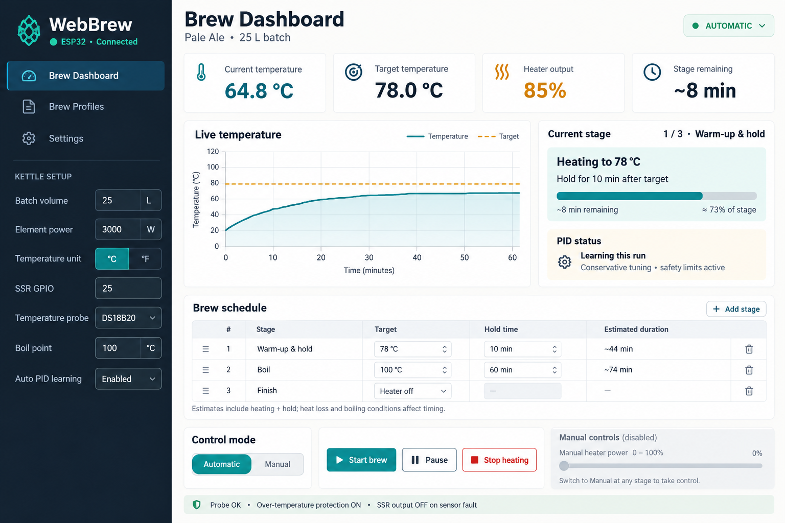

# WebBrew

A local web controller for an electric brewing kettle, running on a **classic ESP32 DevKit / WROOM-32**. The dashboard is embedded in firmware: no cloud account, external web server, CDN, or filesystem upload is needed.



*Original interface concept mockup; displayed readings are illustrative. The implemented dashboard also includes selectable SSR polarity.*

## Features

- Responsive dashboard with kettle settings on the left, live temperature graph, heater output, and remaining-time estimates.
- Celsius / Fahrenheit display and editing; temperatures are stored internally in Celsius.
- Up to eight named warm-up/hold or boil stages, with temperature and duration per stage. Boil stages also have adjustable power.
- Automatic operation after an explicit Start. Hold time accumulates only near the target; finishing the schedule turns heating off.
- Manual power override at any stage, with the schedule timer frozen. Return to Automatic to continue. Pause turns heating off; Stop ends the session.
- Bounded, model-assisted PID adaptation on each run. Heat-up measurements update effective heating efficiency, timing estimates, and PID gains. Learned efficiency is retained for the next run.
- Volume and element-power based estimates, using water's heat capacity as an approximation for water/wort. Cooling stages are not supported.
- Configurable SSR GPIO and active-high / active-low polarity. Firmware enables the internal pull-down / pull-up that reinforces the off state.
- Probe-fault, stale-reading, over-temperature, control-loop-stall, watchdog, and maximum-session protection. Faults latch off and require explicit reset. No automatic resume after a reboot.
- Password-protected setup Wi-Fi access point, optional home Wi-Fi connection, persistent kettle configuration, and browser-local brew profiles.

## Hardware

| Connection | Default | Notes |
|---|---|---|
| SSR control | **GPIO 25** | Active high by default; selectable in Settings |
| DS18B20 data | **GPIO 4** | Externally powered 3-wire probe; 4.7 kΩ pull-up to 3.3 V |
| DS18B20 supply | 3.3 V / GND | Exactly one probe on the bus; parasite power is unsupported |
| SSR off-state bias | External 10 kΩ | Pull-down for active high; pull-up to 3.3 V for active low |

These are common choices for classic ESP32 projects, selected to avoid flash pins, boot-strapping pins, UART0, and input-only pins. SSR choices are restricted to **18, 19, 21, 22, 23, 25, 26, 27, 32, 33**. The probe can also use GPIO 4. The two pins must be distinct. GPIO 16/17 are excluded to avoid PSRAM conflicts on related modules. These defaults do **not** apply to ESP32-S2/S3/C3 boards.

See [the wiring and commissioning guide](docs/HARDWARE.md) before connecting heating power. Internal pull resistors are weak and firmware-configured: they cannot guarantee an off state during power-up, reset, flashing, or power loss. They also do not replace the DS18B20's external 4.7 kΩ data pull-up.

Use an appropriately rated, isolated **zero-cross AC SSR** and heatsink. Verify that its input/driver accepts 3.3 V logic; a quoted “3–32 V” input range alone does not prove compatibility with the ESP32's current limit. An active-low module needs a suitable isolated/logic-compatible input circuit. Never apply 5 V to an ESP32 GPIO. Two-second time-proportional switching is for an SSR, not a mechanical relay or phase-angle dimmer.

**Commission with the heating supply disconnected, then supervise water-only runs.** Firmware checks cannot establish that water is present, detect every dry-fire condition, or disconnect a failed-short SSR. Fit independent thermal/dry-fire protection, a physical power isolator, and appropriate electrical protection. Mains wiring requires a qualified person. Automatic sequencing is implemented; unattended operation is not validated by the software tests.

## Build and flash

Install [PlatformIO](https://platformio.org/install) (Core 6.1.18 is used in CI), then:

```sh
pio run -e esp32dev
# Disconnect heating power before flashing or changing GPIO/polarity.
pio run -e esp32dev -t upload
pio device monitor -b 115200
```

The pinned platform uses Arduino-ESP32 2.0.17. Libraries are pinned in `platformio.ini`. Upload uses USB serial; select `--upload-port` if necessary. This project currently supports only the classic ESP32 target. Firmware and partition images are produced under `.pio/build/esp32dev/`.

On first boot, serial prints the generated Wi-Fi/dashboard password. Connect to **WebBrew-XXXX**, open **http://192.168.4.1**, and sign in with username **brew** and that password. The generated password is stored in NVS and survives reboot. Serial access exposes it intentionally for local provisioning.

1. Confirm probe readings and configure kettle volume, element power, GPIOs and SSR polarity with heating power isolated.
2. Set the local boil point (altitude matters), over-temperature cutoff and session limit. The cutoff must be at least 2 °C above the boil point. Include heat-up time in the session limit.
3. Edit stage targets, hold times, and boil power. Hold stages must be at least 2 °C below the configured boil point. Save the kettle and stages.
4. Optionally configure your home Wi-Fi under Settings. The setup access point remains available.
5. Complete the commissioning checks, then Start brew. Closing the browser does not stop the ESP32. Keep a physical isolator accessible.

Configuration changes are rejected during running/paused sessions and latched faults. A polarity or pin change must match the actual wiring; isolate heating power when making it. Changing the password takes effect for dashboard login immediately; reboot to update the access-point password.

HTTP Basic authentication and a per-boot request token protect local access and write operations. HTTP traffic is not encrypted. Do not expose the device to the public internet or use it on an untrusted network. Passwords are stored in the device's NVS without application-level encryption; physical access is trusted. The API has no permissive CORS policy.

## PID learning and boil control

During eligible automatic warm-up, 30-second windows at ≥60% output and at least 5 °C below target estimate effective efficiency from delivered energy and temperature rise. Windows need ≥0.5 °C rise to qualify. Efficiency is filtered and clamped to 20–100%; gains are bounded to P 5–25, I 0.02–0.12, D 15–75. Learning restarts each run, and manual/paused periods are excluded. The starting gains are derived from configured thermal mass/power and retained efficiency.

This is a **model-assisted adaptive controller**, not a relay-oscillation autotune or a guarantee of optimal PID settings. Short runs or starts near target may have no qualifying learning windows and use the existing model. Probe placement, circulation, kettle geometry, and heat loss affect real behaviour. Verify stability with the actual kettle before relying on it.

At atmospheric boiling, adding power changes evaporation and boil intensity more than liquid temperature. A boil stage heats to the configured boil point, then uses the selected boil power; if temperature drops outside the target band it reheats at full power and pauses hold accumulation. Use the local boiling temperature rather than selecting an unattainable target.

Heating estimate in seconds:

```text
max(0, target °C − current °C) × volume L × 4186 / (element W × effective efficiency)
```

Each stage estimate adds its hold time. The calculation assumes approximately 1 kg/L and water's heat capacity, excludes cooling and boil-off changes in volume, and is approximate for wort.

## Development and tests

```sh
bash scripts/test_native.sh       # C++ controller tests, ASan + UBSan; requires g++
npm ci                           # Browser test tools only; not used by firmware
npx playwright install --with-deps chromium
npm test                         # Browser tests of the interface simulation
python3 scripts/demo_server.py    # Local UI demo; visit /?demo=1 on loopback port 8080
```

If Chromium is already installed, use `CHROMIUM_PATH=/usr/bin/chromium npm test` instead of downloading it. The demo visibly identifies itself as a simulation and never controls hardware. Firmware compilation, host controller tests, and UI tests run in [GitHub Actions](.github/workflows/ci.yml). CI uploads firmware images as an artifact, not a release.

Host tests exercise sensor faults, cutoffs, timeouts, stage transitions, manual/pause behaviour, rollover, polarity mapping, model learning and a simulated full brew. Browser tests cover the interface; they do not validate physical temperature accuracy, electrical wiring, SSR behaviour or unattended safety.

## Project layout

- `src/main.cpp`: hardware, persistent settings, Wi-Fi and authenticated HTTP API.
- `include/controller.h`: portable controller, stage engine, PID adaptation and estimates.
- `web/index.html`: offline, dependency-free dashboard and explicitly marked interface demo.
- `scripts/embed_web.py`: embeds the dashboard in flash during a PlatformIO build.
- `test/`: native controller and browser tests.
- `docs/`: hardware commissioning and API reference.

