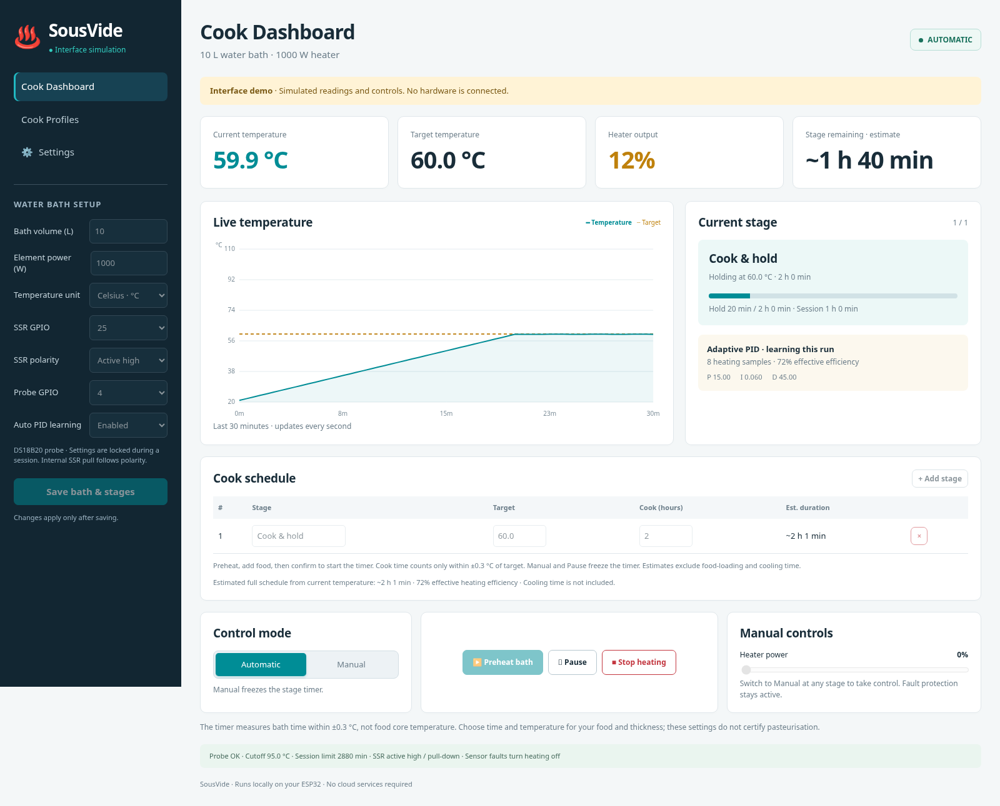

# SousVide for Arduino IDE · v0.3

A separate Arduino IDE version for controlling a sous-vide water bath with the same ESP32, DS18B20 and SSR hardware. Open [`arduino/SousVide/SousVide.ino`](../arduino/SousVide/SousVide.ino). The complete firmware and offline web interface are included in that folder.

*Screenshot of the interface simulation. Displayed readings are illustrative.*

## Install and connect

Use Arduino IDE 2.x with **esp32 by Espressif Systems 2.0.17**, board **ESP32 Dev Module**, and these Library Manager versions:

| Library | Version |
|---|---|
| OneWire | 2.3.8 |
| DallasTemperature | 3.11.0 |
| ArduinoJson | 7.2.1 |

Keep `SousVide.ino`, `firmware.cpp`, `controller.h` and `web_page.h` together in the `SousVide` folder. Upload over USB with heating power disconnected. No PlatformIO or separate filesystem upload is required. See [the detailed Arduino installation guide](../arduino/README.md) for Boards Manager setup.

Open Serial Monitor at **115200 baud**. Connect to **SousVide-XXXX** with the generated password printed on serial, then visit **http://192.168.4.1**. The dashboard username remains **brew**; use the printed password. Home Wi-Fi can be configured through Settings.

This firmware stores its own settings and password in a separate NVS namespace, so brewing settings cannot accidentally become the sous-vide cooking schedule. Flashing back to WebBrew restores its separately retained settings. Never switch firmware while heating power is connected.

## Cooking workflow

1. Fill the bath to safely immerse the heater. Set actual bath volume and element power, and check probe readings with a calibrated reference thermometer.
2. Enter the target temperature and cooking duration in **hours**. Celsius and Fahrenheit are supported. The default example is 60 °C for 2 hours; it is not a food-specific recipe.
3. Set a temperature cutoff at least 2 °C above every stage target, and a maximum session time that includes preheating, food-loading time, cooking, pauses and manual operation. Save bath and stages.
4. Click **Preheat bath**. The controller heats and regulates the bath; cooking time stays at zero.
5. When the measured bath is within ±0.3 °C of target, add the bagged food and click **Food added · Start timer**. If loading cools the bath outside the band, the timer waits until it returns.
6. Cooking time accumulates only while the measured bath stays within **±0.3 °C** of the current stage target. Both cold dips and overshoot pause accumulation. Manual mode and Pause also freeze the timer; Pause turns heating off.
7. At the end of the last stage, heating turns off. Remove and handle the food appropriately; there is no automatic keep-warm stage.

After the initial food confirmation, additional stages proceed automatically and time only within their respective temperature bands. A lower next-stage target requires passive cooling; there is no cooler or cooling-time estimate. A new session always requires a new food-added confirmation.

## Sous-vide settings

| Setting | Range / default |
|---|---|
| Target temperature | 40–90 °C; default 60 °C |
| Cooking time per stage | Up to 48 hours; default 2 hours |
| Maximum session time | Up to 72 hours; default 48 hours |
| Temperature cutoff | 42–95 °C and at least 2 °C above every target; default 95 °C |
| Bath volume | 1–200 L; default 10 L |
| Heater power | 100–12000 W; default 1000 W |
| SSR / probe GPIO | GPIO 25 / GPIO 4 |
| SSR polarity | Active high by default; active low selectable |

Boil stages and boil-power controls are unavailable in the sous-vide version. Regular PID control applies to all cooking stages. Automatic heat-up learning, heating estimates, manual output, probe fault handling, latched cutoffs, internal SSR pull selection and watchdog behaviour are retained.

The Cook Profiles page includes editable **bath templates**, not food-specific recipes: Standard bath (60 °C / 2 h), Long hold (65 °C / 8 h), and Hot bath (85 °C / 1 h). Loading a template does not start heating; customise it and save. Your own cook profiles are stored in the browser separately from brew profiles.

## Bath accuracy and food timing

The ±0.3 °C band is a **control/timer band around the measured temperature**, not a guarantee of absolute temperature accuracy. DS18B20 accuracy, probe calibration, placement and circulation matter. Use suitable externally powered water circulation; this version does not control or monitor a pump. Check that the bath is uniform and that the probe measures representative water temperature.

The timer measures bath time, **not food core temperature**. It does not model food thickness, starting temperature, heat penetration, pathogen reduction or cooling/storage. Use an authoritative sous-vide recipe and food-safety guidance for the actual food and thickness; low-temperature options and example templates do not certify pasteurisation. Interrupted/out-of-band intervals accumulate separately and are not a validated continuous pasteurisation hold.

The hardware has no liquid-level or pump-flow input. Long cooks need water-level management and independent thermal/dry-fire protection. Read [the hardware commissioning guide](HARDWARE.md), supervise initial water-only trials, and keep a physical isolator accessible. Software cannot disconnect a failed-short SSR.

## API and local demo

The normal [HTTP API](API.md) also applies, with `sousVide: true` in configuration. The sous-vide sketch rejects configurations with false/missing mode, boil stages or out-of-range targets. A status response includes `foodAdded`.

After preheating, send `{"action":"foodAdded"}` to `/api/command` with authentication and the per-boot request token. It is accepted only in running automatic mode with a fresh in-band reading and no previous food confirmation. Stop/fault/reboot never resumes a cook automatically.

For an interface-only demo, run `python3 scripts/demo_server.py` from the repository root and use `/?demo=1&mode=sousvide` on its local loopback server. The page clearly labels the simulation and never controls hardware.
